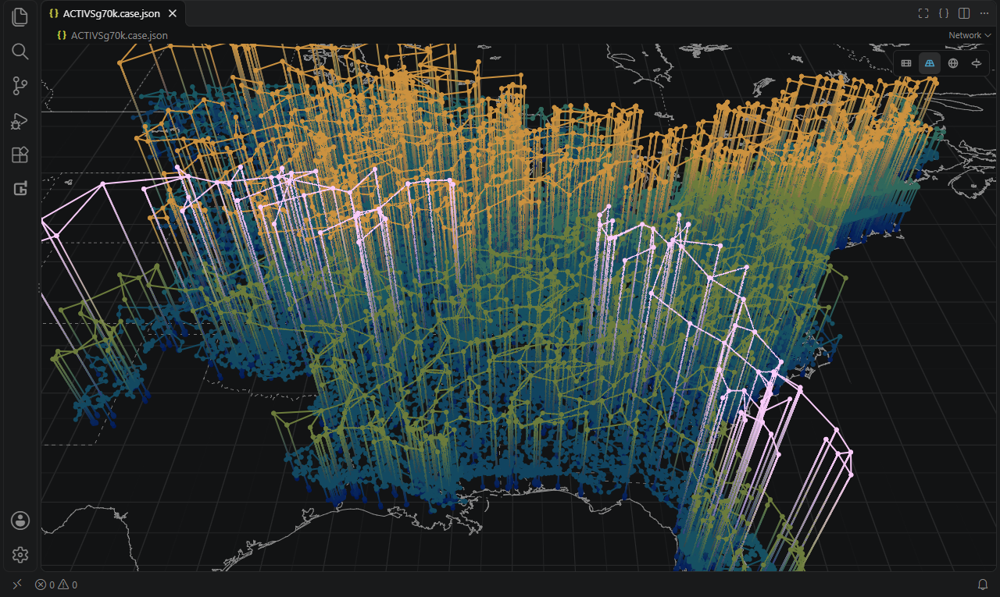
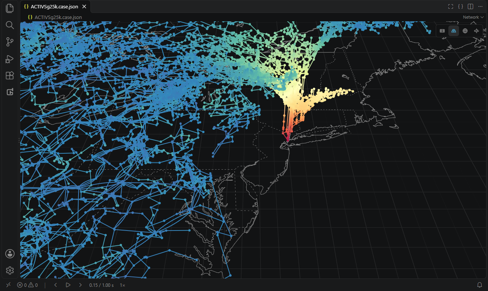
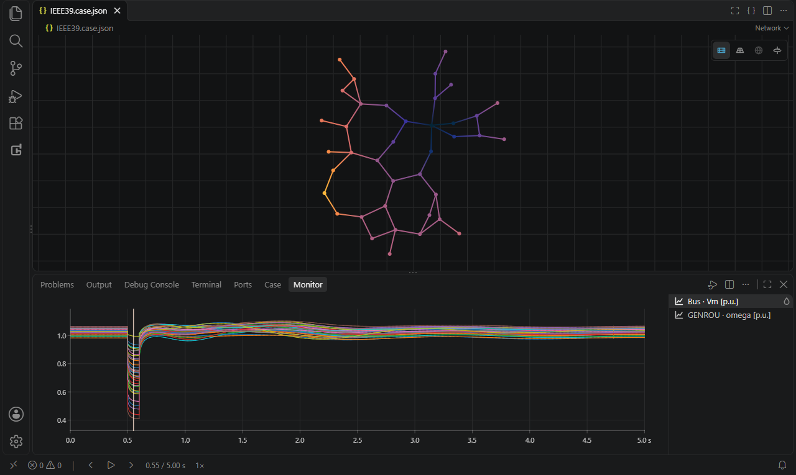

# GridKit Studio

[](https://github.com/lukelowry/gridkit-studio/actions/workflows/ci.yml)
[](https://github.com/ORNL/GridKit/tree/develop)
[](https://code.visualstudio.com/)
[](https://github.com/lukelowry/gridkit-studio/releases)
[](LICENSE)

View and simulate [GridKit](https://github.com/ORNL/GridKit) power-system cases in VS Code.



## Install

Install **GridKit Studio** from the [Marketplace](https://marketplace.visualstudio.com/items?itemName=lukelowery.gridkit-studio), then open any `*.case.json` file. Requires VS Code 1.141 or later, and a GPU with WebGL 2.

## GridKit

GridKit is included on desktop and web. To use your own installation, set its directory or executable path:

```json
"gridkitStudio.gridkitPath": "/opt/gridkit"
```

Clear the setting to use the included solver again. In remote workspaces, the path is on the remote machine.

## How to use

Right-click a `*.solver.json` and choose **Run Dynamic Simulation**. The Monitor plots results as GridKit runs. On the web, results stay in your browser. Use **Export CSV** to download them.

- **Open Results…** in the Monitor shows any other CSV GridKit wrote.
- The Monitor panel lists enabled monitors. Right-click one to map it onto the network.

## Features

- Network view
- Case panel for sorting and filtering fields, and mapping them onto the network. What you select in the table shows on the network, and the other way around.



_ACTIVSg25k during a fault, with voltage magnitude shown as color and height_

- Dynamic simulation from a solver file's menu
- Monitor for plotting and playing back signals



_IEEE39 during a fault, with voltage magnitude on the network and in the Monitor_

- Image export to PNG, JPEG and WebP, and video export to MP4/H.264

## Author

[Luke Lowery](https://lukelowry.github.io/), PhD student in the [Birchfield Research Group](https://birchfield.engr.tamu.edu/) at Texas A&M University · [Google Scholar](https://scholar.google.com/citations?user=CTynuRMAAAAJ&hl=en) · [ORCID](https://orcid.org/0009-0000-0029-3403)

## License

[MIT](LICENSE). See [third-party notices](THIRD_PARTY_NOTICES.md).

Uses [GridKit](https://github.com/ORNL/GridKit) from Oak Ridge National Laboratory and cases from the [Texas A&M Electric Grid Test Case Repository](https://electricgrids.engr.tamu.edu/electric-grid-test-cases/).
