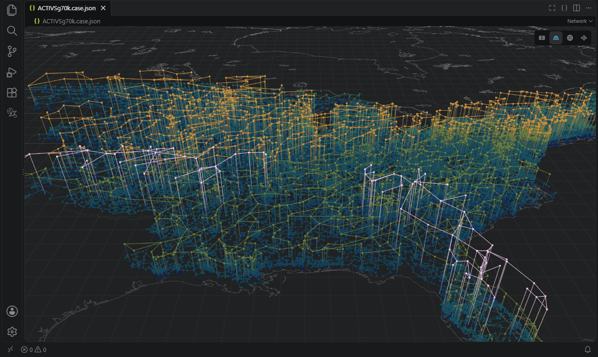
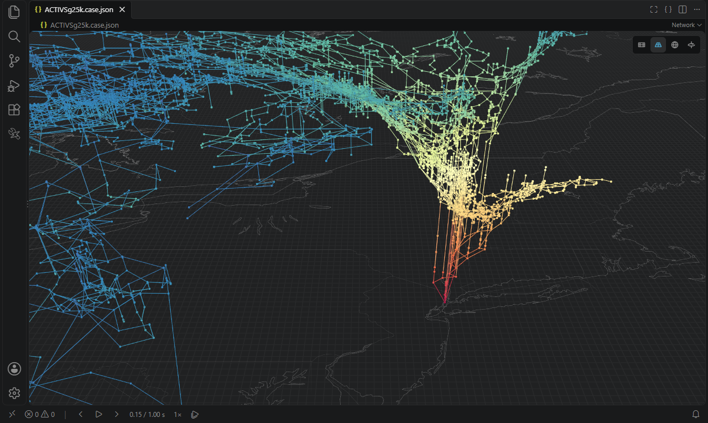
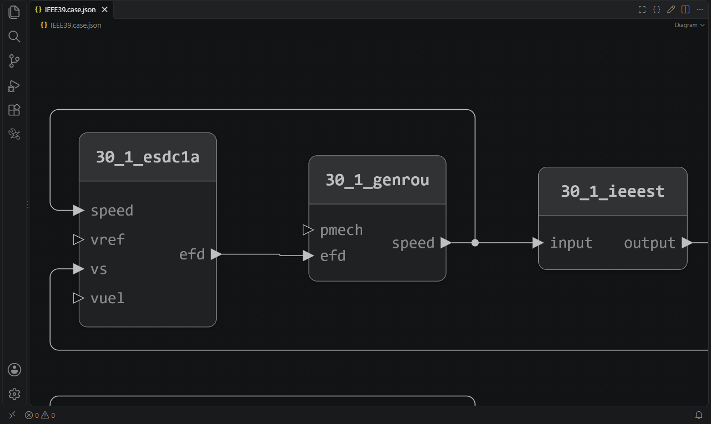
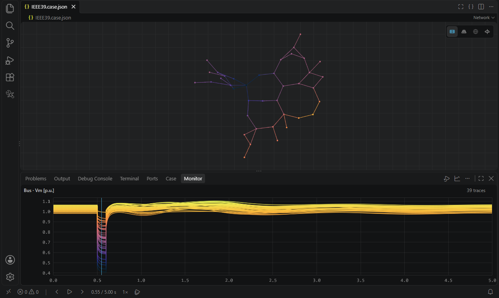

# GridKit Studio

[](https://github.com/lukelowry/gridkit-studio/actions/workflows/ci.yml)
[](https://github.com/ORNL/GridKit/releases/tag/v0.2.0)
[](https://code.visualstudio.com/)
[](https://github.com/lukelowry/gridkit-studio/releases)
[](LICENSE)

View, edit, and simulate [GridKit](https://github.com/ORNL/GridKit) power-system cases in VS Code.



## Install

Install **GridKit Studio** from the [Marketplace](https://marketplace.visualstudio.com/items?itemName=lukelowery.gridkit-studio), then open any `*.case.json` file. Requires VS Code 1.140 or later and WebGPU.

## GridKit

Studio runs GridKit from an install or from a container image.

**Install.** Set the folder GridKit is installed in. Leave it empty if GridKit is on your `PATH`.

```json
"gridkitStudio.gridkitPath": "/opt/gridkit"
```

**Image.** Pull the image with Docker or Podman. It is the default, so the setting only changes for another image. The default names one GridKit build, `0.2.0-perf`, by its digest, so it stays the same when a tag moves.

```sh
docker pull ghcr.io/lukelowry/gridkit@sha256:640bfc0d630de5f0a919338005a99967a8cfdeda90849d5f5290814daade8985
```

```json
"gridkitStudio.gridkitImage": "ghcr.io/lukelowry/gridkit@sha256:640bfc0d630de5f0a919338005a99967a8cfdeda90849d5f5290814daade8985"
```

## How to use

Right-click a `*.solver.json` and choose **Run Dynamic Simulation** or **Run Contingency Analysis**. GridKit runs in the solver file's folder, the same as it would from a shell, and the Monitor plots what it writes.

- **Monitored Signals** chooses what the case records.
- **Show Results** on a solver file shows what its last run wrote, and **Run Again** in the Monitor runs it again.
- **Open Results…** in the Monitor shows any other output.

## Features

- Network editor
- Case panel for editing, sorting and filtering fields, and mapping them onto the network. What you select in the table shows on the network, and the other way around.



_ACTIVSg25k during a fault, with voltage magnitude shown as color and height_

- Diagram editor for control blocks and how they're wired



_An IEEE39 generator with its exciter and stabilizer in the diagram_

- Dynamic simulation and contingency analysis from a solver file's menu
- Monitor for plotting and playing back signals



_IEEE39 during a fault, with voltage magnitude on the network and in the Monitor_

- Video export to MP4 or WebM

## Author

[Luke Lowery](https://lukelowry.github.io/), PhD student in the [Birchfield Research Group](https://birchfield.engr.tamu.edu/) at Texas A&M University · [Google Scholar](https://scholar.google.com/citations?user=CTynuRMAAAAJ&hl=en) · [ORCID](https://orcid.org/0009-0000-0029-3403)

## License

[MIT](LICENSE). See [third-party notices](THIRD_PARTY_NOTICES.md).

Uses [GridKit](https://github.com/ORNL/GridKit) from Oak Ridge National Laboratory and cases from the [Texas A&M Electric Grid Test Case Repository](https://electricgrids.engr.tamu.edu/electric-grid-test-cases/).
